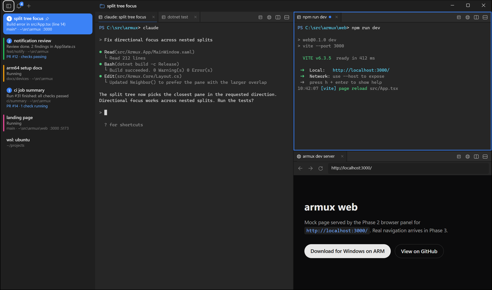

# armux

A terminal workspace app for **Windows 11 on ARM64**, modeled on [cmux](https://github.com/manaflow-ai/cmux) for macOS: vertical workspace sidebar, split panes, a browser beside your terminal, and notification rings when a coding agent needs you.

[](https://github.com/apaslam09/armux/actions/workflows/ci.yml)

> **Status: Phase 2 (UI on mock data).** The full cmux-style interface runs, but terminals show mock text. Real shells (PowerShell, cmd, WSL through ConPTY), OSC notifications and the `armux` CLI arrive in Phase 3. See the [roadmap](ARCHITECTURE.md#roadmap).



## Why

- **Native ARM64.** Built with WinUI 3 and published as NativeAOT for `win-arm64`. CI checks the release binary has PE machine type `0xAA64`, so it never runs under x64 emulation.
- **cmux's UI and model.** The same Window > Workspace > Pane > Surface hierarchy, workspace colors, notification rings, command palette and a shortcut layout mapped to Windows. Every UI element traces to a cmux feature ([traceability table](ARCHITECTURE.md#5-feature-traceability)).
- **Measured memory.** Idle on a Surface Laptop 7: about 95 MB working set, 47 MB private and 25 MB in Task Manager, starting in 156 ms. Numbers for every scenario, including the browser panel, are in [ARCHITECTURE.md](ARCHITECTURE.md#7-memory-budget), with the scripts to reproduce them.

## Features

| Feature | Status |
|---|---|
| Vertical sidebar: workspace title, latest notification, branch · directory, ports, PR, unread badge | Done (mock data) |
| Workspace colors (17 presets or custom) shown as a left rail or underline; pinned workspaces | Done |
| Per-pane tab bars, split right / down, drag to resize, zoom, equalize | Done |
| Command palette (`Ctrl+Shift+P`) with inline shortcuts and workspace switching | Done |
| Notification rings, tab dots, bell with unread count, notification panel, jump to latest unread | Done (simulated notifications) |
| Built-in browser panel (WebView2): lazy, suspended when hidden, at most 2 live, fully released when closed | Done (mock page) |
| Dark and light themes | Done |
| PowerShell 7, cmd and WSL through ConPTY | Phase 3 |
| OSC 9 / 99 / 777 notification detection, Windows toasts | Phase 3 |
| `armux notify` CLI and named-pipe API | Phase 3 |

More screenshots: [command palette](docs/screenshots/02-command-palette.png), [notifications](docs/screenshots/03-notifications.png), [workspace colors](docs/screenshots/05-workspace-colors.png), [zoomed pane](docs/screenshots/06-zoomed-pane.png), [light theme](docs/screenshots/07-light-theme.png), [four-pane grid](docs/screenshots/08-four-pane-grid.png).

## Requirements

- Windows 11 on ARM64 (developed on a Surface Laptop 7, Snapdragon X Plus)
- Windows App Runtime 1.8 and the WebView2 Runtime (both usually preinstalled on Windows 11)

## Build from source

See [CONTRIBUTING.md](CONTRIBUTING.md#setup) for the full setup. In short:

```powershell
git clone https://github.com/apaslam09/armux
cd armux
dotnet test --project tests/Armux.Core.Tests
dotnet publish src/Armux.App -c Release -r win-arm64 -p:Platform=ARM64 -o publish
publish\ArmuxApp.exe
```

## Measuring memory

```powershell
./scripts/measure-memory.ps1 -Name ArmuxApp
./scripts/bench.ps1 -Exe publish/ArmuxApp.exe -ArgumentList '--scenario','idle'
```

`measure-memory.ps1` sums working set, private bytes and Task Manager memory across the app and every process it starts (WebView2, ConPTY hosts, shells), and reports app cost and shell cost separately. `bench.ps1` adds cold-start time.

## Relationship to cmux

armux is an independent project, not affiliated with Manaflow. cmux is GPL-3.0-or-later and armux is MIT, so armux contains **no cmux source code or assets**. It is reimplemented from cmux's public docs and screenshots. See [ARCHITECTURE.md](ARCHITECTURE.md#3-cmux-license-decision).

## Contributing

Contributions are welcome, especially from people on Windows on ARM hardware. Start with [CONTRIBUTING.md](CONTRIBUTING.md) and issues labeled [`good first issue`](https://github.com/apaslam09/armux/labels/good%20first%20issue). No ARM64 device? CI builds and checks every PR on a native ARM64 runner.

## License

[MIT](LICENSE)
